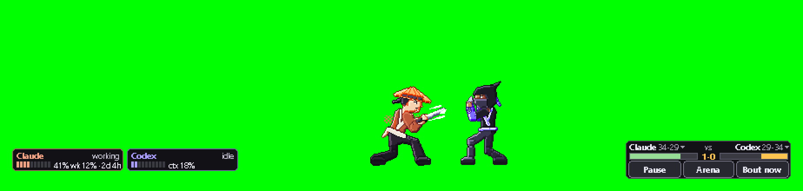

# Streamer mode

Show the fight on stream. `python minis.py stream on` opens an ordinary window, **Taskbar Fighters — Stream**, with the
live fight strip (both fighters, their HUD plates, the scoreboard) on a solid chroma-key background. Add that window to
OBS and key the colour out.

Rendered offline by `python tools/stream_preview.py` from synthetic window images (DEMO numbers), through the same code
path the stream window uses. It is not a screen capture.

## Commands

| command | what it does |
| --- | --- |
| `python minis.py stream on` | open the stream window (a background process; the fighters must be running) |
| `python minis.py stream off` | close it (or close the window yourself) |
| `python minis.py stream status` | is it running, which key colour |
| `python minis.py stream snapshot out.png` | one frame of exactly what the window shows, written to a file |

Options for `stream on` (and `snapshot`):

| option | default | meaning |
| --- | --- | --- |
| `--chroma #RRGGBB` | `#00FF00` | the key colour; `magenta`, `blue`, `black` and `r,g,b` also work. Pick one that is not in the art: green and magenta are safe |
| `--scale N` | fit | a fixed whole-number scale. Without it the strip is scaled by the largest whole number that fits the window |
| `--fps F` | `15` | frames per second (2 to 30) |
| `--width W --height H` | `960 x 300` | the starting size of the window's inside |
| `--no-plates` | off | leave the HUD plates out (they show context % and plan figures; leave them out if you would rather not show those numbers) |
| `--transparent` | off | an alpha background instead of the key colour (experimental, see below) |

Resize the window freely: the picture always snaps to a whole-number scale (2x, 3x, ...), so the pixel art stays crisp,
and the space around it is filled with the key colour.

The tray menu has the same switch: **Streamer mode (OBS window)**.

## OBS setup (Windows)

1. `python minis.py stream on`.
2. In OBS: **Sources > + > Window Capture**. Window: `[pythonw.exe]: Taskbar Fighters — Stream` (or
   `[TaskbarFighters.exe]` in the zip build). Capture Method: **Windows 10 (1903 and up)**. Untick *Capture Cursor*.
3. Right-click the source > **Filters > Effect Filters > + > Chroma Key**. Key Colour Type: **Green** (or **Custom** with
   the colour you passed to `--chroma`). Start with Similarity 80-120 and Smoothness 30-60.
4. Size it in the scene. For the sharpest pixels, right-click the source > **Scale Filtering > Point**.

The window may be behind other windows or minimised to a small size: Windows Graphics Capture still sees it. A minimised
window is not drawn by Windows, so do not minimise it while you are live.

## OBS setup (macOS, experimental)

1. `python minis.py stream on` (the Python process gets a Dock icon while it streams).
2. In OBS: **Sources > + > macOS Screen Capture**, Method **Window Capture**, pick *Taskbar Fighters — Stream*. macOS asks
   **OBS** (not Taskbar Fighters) for the Screen Recording permission the first time; that is OBS's own capture.
3. Add the same **Chroma Key** filter as on Windows.

Not yet run on a real Mac: see [MAC-HANDOFF.md](MAC-HANDOFF.md) MAC-23.

## Transparency instead of a key colour

`python minis.py stream on --transparent` draws the strip on a fully transparent background (Windows: a layered window;
drag it anywhere to move it, drag the bottom-right corner to resize it, right-click or Esc closes it. macOS: a window that
is not opaque).

Whether a capture keeps that alpha depends on the capture tool, and **it has not been verified with OBS**:

- OBS's **Allow Transparency** checkbox belongs to the **Game Capture** source, not to Window Capture. Game Capture hooks
  games that draw with Direct3D or OpenGL; the stream window draws with plain Win32 calls, so Game Capture cannot hook it.
- Window Capture has no transparency option. If your OBS shows the transparent window on black or on the desktop behind
  it, use the default key colour instead: that is the dependable path.

## What it shows, and what it never does

- **Its own pixels only.** While the stream runs it writes a dump request (`<data folder>/dump/request.json`, id
  `stream`); every fighter, plate and scoreboard process then also writes the exact image it hands to its own window into
  `<data folder>/dump/stream/`. The stream reads the newest image of each, pastes it at that window's position, deletes
  what it has used, and removes the request and the folder when it closes. No screen capture, no window title, nothing
  from another program.
- **Desktop weapons are switched off while you stream** (the arena's RAM-only screen grab). `stream off` puts back what
  was there before; `python minis.py forge on` turns them back on at any time.
- The window is a normal app window: not topmost, not click-through, in the taskbar and Alt-Tab. Closing it ends the
  stream process; the fighters keep running.
- `tools/own_capture.py` uses the same dump mechanism. While it runs, the stream reads its folder and leaves its files
  alone.
- The arena (`minis.py arena`) is a separate full-monitor overlay. The stream window shows the taskbar fight; to stream an
  arena match, capture that monitor with OBS's display capture (with `forge off` the arena never grabs the screen).

## Ideas for streamers

- Your platform's own **predictions** ("who wins this match?") pair well with the scoreboard: open one when a match starts
  (`python minis.py demo match`, or the scoreboard's *Bout now*). Taskbar Fighters never connects to Twitch, YouTube or
  any chat: there is no network in the app.
- `python minis.py card` makes a 1200 x 675 picture of your agents' record for a stream panel or an end screen.
